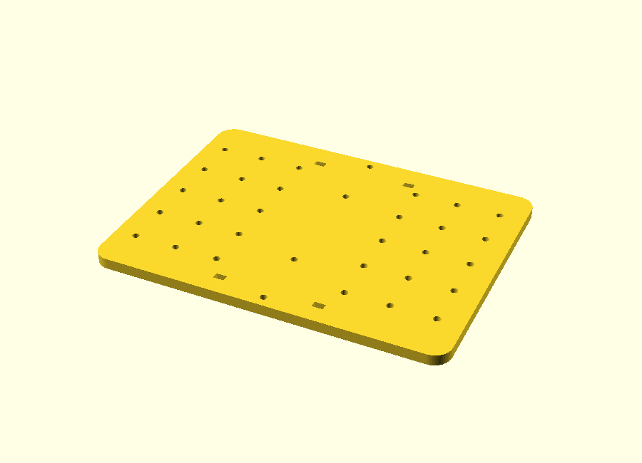
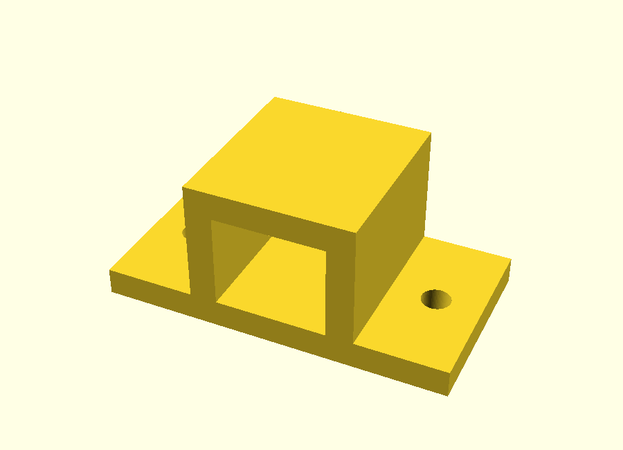
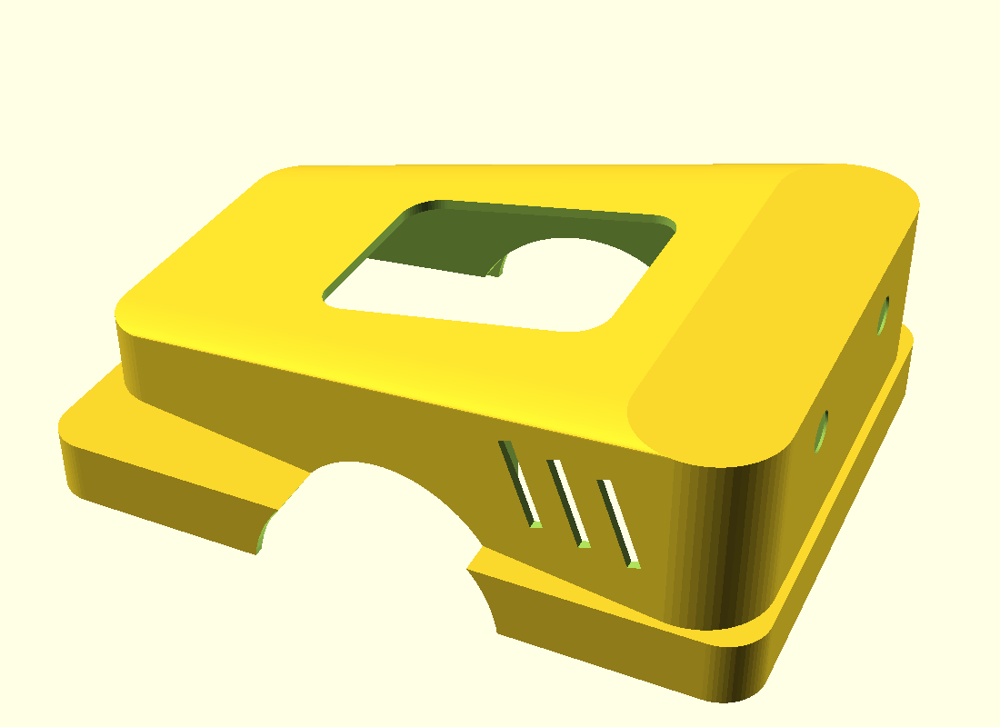
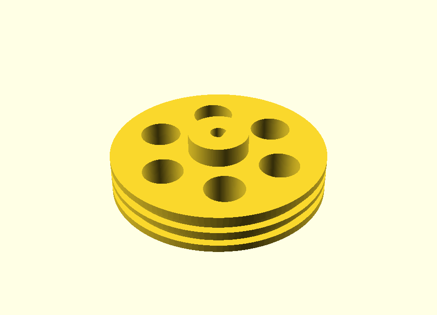
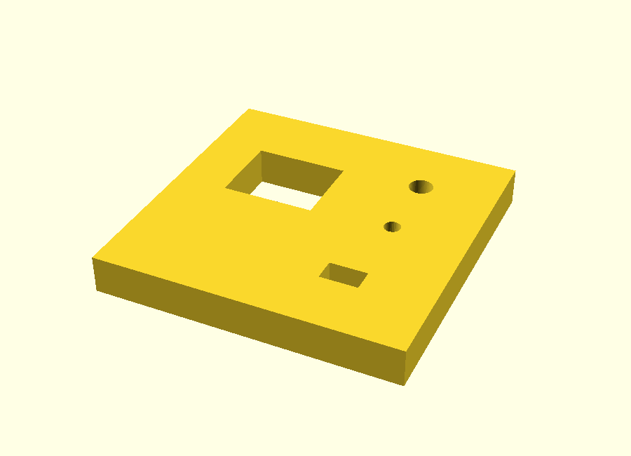
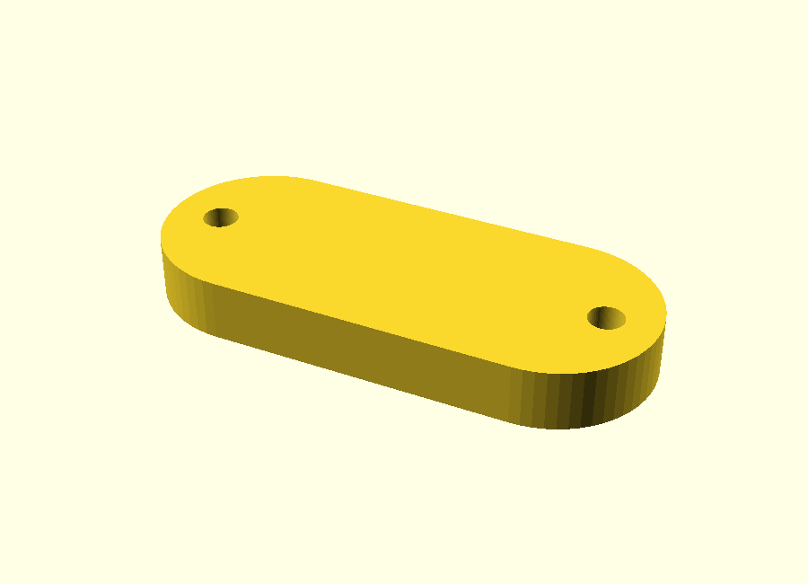

# SLAM Rover

A budget (~$400 CAD) SLAM-capable autonomous rover: 3D-printed chassis CAD, simulation-tested Pico W firmware, wiring plans, risk analysis, and a staged bill of materials. Next up: pointing it at a real infrastructure problem ([see below](#infrastructure-use-case)).

**What's here and how far it's been validated:**
- **Firmware** (MicroPython, Pico W): motor control, PIO quadrature encoders, WiFi/USB command protocol with fail-safe watchdog — validated 9/9 in a [host-side simulation harness](pico/host_test/run_sim.py)
- **CAD**: parametric chassis system — plate, motor clamps, and tolerance test coupon (Onshape); wheels, caster spacer, and body shell (OpenSCAD, sources included) — structural parts printed and dry-fitted on a Bambu P1S
- **Engineering docs**: [decision log](docs/decisions.md) (D1–D9), [risk register](docs/risks.md) (R1–R10), [staged BOM](docs/shopping-list.md), [build roadmap](docs/roadmap.md), [debugging log](docs/debugging-log.md)
- Hardware bring-up (motors/lidar/SLAM on the physical robot) is the next step — the [phase 1 guide](docs/phase1-guide.md) is the runbook

## How it's made

1. **Design and print the chassis.** The differential-drive layout puts two N20 motors beside a 160 × 120 mm plate, a caster at the rear, and the battery near the wheel axle. The plate, motor clamps, and fit coupon were modeled in Onshape; the [chassis design spec](cad/chassis-design.md) records the dimensions and layout choices. The [OpenSCAD sources](cad/) generate the wheels, caster spacer, and body shell. The structural parts have been printed and dry-fitted on a Bambu P1S; the STL files and previews are in `cad/`.
2. **Control the wheels with a Pico W.** The planned wiring connects the Pico to an H-bridge motor driver and the two motor encoders ([pin map and bring-up order](docs/phase1-guide.md)). The existing [MicroPython firmware](pico/main.py) drives each motor with PWM, while [PIO encoder counting](pico/encoder.py) tracks wheel movement. It accepts `M <left> <right>` over USB serial or WiFi UDP and reports `E <left_count> <right_count>` at 20 Hz. If valid commands stop for 400 ms, it stops both motors.
3. **Drive it from a computer.** The [WASD teleop script](teleop/teleop_wasd.py) mixes forward and turn inputs into left and right motor commands, then sends them 10 times a second over serial or UDP. That repeating command is the firmware watchdog's heartbeat.
4. **Add mapping after hardware bring-up.** The intended next layer is a Raspberry Pi 5 running Ubuntu 24.04 and ROS 2 Jazzy. It will bridge motor commands and encoder counts, publish wheel odometry, take lidar scans, and feed both into `slam_toolbox` ([roadmap](docs/roadmap.md)). The [physical bring-up guide](docs/phase1-guide.md) is here too, with the wiring, assembly, and first-test steps. The ROS 2 nodes and physical SLAM tests are still planned.

The firmware's command handling and watchdog passed all 9 checks in the [host-side simulation harness](pico/host_test/run_sim.py). Encoder behavior, motor wiring, and the complete rover still need tests on the physical hardware.

## Infrastructure use case

**Leak hunting: the rover maps a basement or crawl space and marks where the water is.**

Hidden leaks under houses (dripping pipes, a seeping foundation wall, a failing water heater) rot wood and grow mold for months before anyone notices, because nobody wants to crawl under there and look. An inspector checks a few spots by hand. The rover drives the whole space and hands back one picture: the lidar floor map with damp spots glowing on it.

**How it works.** Water cools whatever it soaks as it evaporates, so a wet patch of wall or floor reads a few degrees colder than the dry surface around it. That's how thermal cameras find leaks.

1. An **MLX90614 infrared thermometer** (~$15) points at the wall beside the rover and reads its surface temperature. An **SHT31** (~$10) reads air temperature and humidity. Both connect to the Pi over I2C, so the Pico firmware doesn't change.
2. A `moisture_logger` ROS 2 node reads the sensors at 5 Hz and stamps each reading with the rover's position from the `map → base_link` transform slam_toolbox already publishes.
3. Readings get binned into the same grid as the occupancy map. Any cell colder than the surrounding wall by more than a set threshold (start at 2 °C) gets flagged.
4. Output: one PNG of the floor map with a cold-spot heatmap on top and the flagged spots circled. A Pi camera snapshot of each flagged spot is the stretch goal.

**Demo.** Hide a wet towel and an ice pack against the walls of a room, drive one lap, and the map lights up in the right places. Then do it for real in a basement.

**Why this one:** it reuses everything the rover already does (map, position, Pi), adds about $25 of sensors, and ends with a result you can see at a glance.

## Gallery

| | | |
|---|---|---|
|  |  |  |
| Chassis plate (34-hole grid system) | Motor clamp (N20, no-fastener tunnel) | Body shell (printable car-body skin) |
|  |  |  |
| Drive wheel (rubber-band tires, D-bore) | Tolerance test coupon | Parametric caster spacer |

## Hardware

| Component | Choice | Rationale | Status |
|---|---|---|---|
| Compute | Raspberry Pi 5 | Runs ROS2 + SLAM | Decided |
| Real-time motor control | Raspberry Pi Pico | PWM + **encoder counting** (PIO) | Decided |
| Sensing | RPLidar A1 | Direct `LaserScan` fit for slam_toolbox ([D2](docs/decisions.md)) | Proposed |
| Chassis | **3D-printed diff-drive plate + caster** (Bambu P1S) | Skid-steer corrupts odometry; printing saves $ and adds CAD to portfolio ([D5](docs/decisions.md)) | Proposed |
| Motors | **N20 gearmotors with quadrature encoders** | SLAM needs odometry — encoders are not optional ([R1](docs/risks.md)) | Proposed |
| Motor driver | TB6612FNG or Cytron MDD3A (**not L298N**) | L298N wastes 2–4 V as heat ([D6](docs/decisions.md)) | Proposed |
| Power | Battery → motor rail + separate 5V/5A buck → Pi | Shared rail = brownout reboots ([D7](docs/decisions.md)) | Proposed |

3D printing (Bambu P1S) covers all *structure*: chassis plate, motor mounts, wheel hubs, lidar mast, Pi/Pico tray. Drivetrain internals (motors, gears, caster) stay off-the-shelf. Budget: **~$340–425 CAD total, bought in three stages of ~$90–165** ([shopping-list.md](docs/shopping-list.md)).

## Software Stack

- **ROS2 Jazzy** on Ubuntu 24.04 — *not Humble*: Humble's Ubuntu 22.04 doesn't support the Pi 5 ([D1](docs/decisions.md))
- **slam_toolbox** for SLAM
- **Nav2** for autonomous navigation (stretch goal)
- **Python** for ROS2 nodes; **MicroPython + PIO** on the Pico ([D4](docs/decisions.md))
- Dev environment: WSL2 (learning) + headless Pi + Foxglove Studio (live viz) ([D8](docs/decisions.md))

## Phased Build Plan (~6–8 weeks)

### Phase 0 (Week 0) — Order parts & set up dev environment
Shipping eats calendar time — order **Stage 1** of the [shopping list](docs/shopping-list.md) now (later stages get bought as earlier ones succeed). Meanwhile, all $0: WSL2 + Ubuntu 24.04 + ROS2 Jazzy on the Windows machine; chassis CAD in Onshape; firmware drafted in the Wokwi simulator; GitHub repo created ([D9](docs/decisions.md)). The Pi gets flashed when the Stage 2 box arrives (~week 2).

### Phase 1 (Weeks 1–2) — Get it moving
Assemble chassis, wire motor driver + Pico + two-rail power. Pico firmware: PWM drive, **encoder counting via PIO**, serial protocol, **command watchdog (fail-safe stop, [R4](docs/risks.md))**. Keyboard teleop over SSH. **No ROS2 yet** — isolate hardware learning from software learning.

### Phase 2 (Weeks 3–4) — ROS2 fundamentals + sensing + odometry
Two parallel tracks:
- **Learning track (WSL2, no robot):** nodes, topics, pub/sub, launch files, tf basics.
- **Robot track (Pi):** lidar publishing `LaserScan`; serial-bridge node (`cmd_vel` → Pico, encoder counts → Pi); **odometry node** publishing `odom` + the `odom → base_link` transform. Doing odometry here keeps Phase 3 from overloading.

### Phase 3 (Weeks 5–6) — SLAM integration
slam_toolbox + tf tree (`map → odom → base_link → laser`). Debug coordinate frames, lidar mounting/orientation ([R8](docs/risks.md)), drift; tune. Drive the room, save a clean map.

**✅ Success checkpoint: a rover that maps a room cleanly is a strong standalone demo, even if Phase 4 isn't reached.**

### Phase 4 (Stretch) — Autonomy
Nav2 for point-to-point autonomous navigation. Prep item: closed-loop wheel velocity control (PID on the Pico) makes Nav2 behave much better than open-loop PWM.

### Phase 5 — Leak hunting
Mount the MLX90614 and SHT31 on the Pi's I2C bus, write the `moisture_logger` node, and render the cold-spot heatmap over the saved map ([use case above](#infrastructure-use-case)). Only needs Phase 3 (a working map), not Phase 4.

## Repo Layout

```
docs/
  roadmap.md         # Beginner roadmap: milestone ladders, concepts, definitions of done
  phase1-guide.md    # Full Phase 1 execution plan: wiring, firmware steps, pin map
  shopping-list.md   # Staged cart (~$340–425 CAD total, 3 purchases)
  debugging-log.md   # Running log: what broke, why, how it was fixed
  decisions.md       # Design decisions D1–D9 with rationale
  risks.md           # Known failure modes R1–R10 and mitigations
pico/                # Pico firmware: main.py + encoder.py + concept walkthrough (WRITTEN — verify at bring-up)
teleop/              # PC-side WASD driving script (WiFi/UDP or USB serial)
cad/                 # Chassis design spec for Onshape (plate, clamps, test-fit coupon)
ros2_ws/             # ROS2 workspace (Phase 2+)
```

**Start here:** [docs/roadmap.md](docs/roadmap.md) — the phase-by-phase ladder — and [docs/shopping-list.md](docs/shopping-list.md) for what to order.

## Debugging Log

Every non-trivial problem gets an entry in [docs/debugging-log.md](docs/debugging-log.md) — symptom, root cause, fix. This doubles as interview storytelling material.
